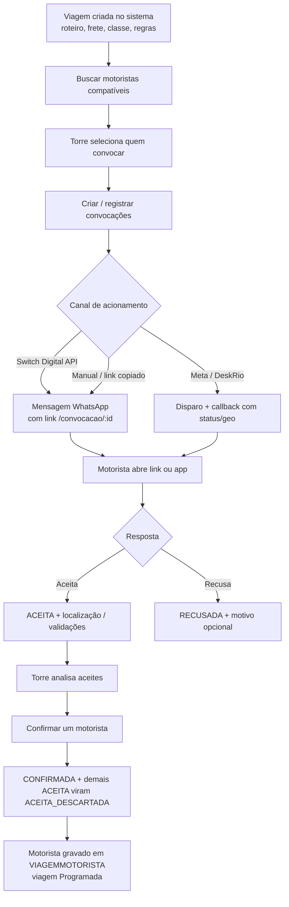

# Atlas Cargo — História de concepção, fluxos operacionais e evolução do produto

**Para quem é este texto:** quem precisa *entender a alma do sistema* — não só uma lista de telas, mas **por que existe**, **como nasceu**, **como o frete “anda” do cadastro ao motorista** e **para onde a plataforma continua evoluindo**.

**Nota técnica:** o produto comercial chama-se **Atlas Cargo**; o repositório pode ser referido internamente como **SysScopel**. Onde a documentação fala em **Divulga Cargas** ou módulo `divulga_cargas_torre`, trata-se da **linha de produto** ligada à divulgação de demandas e convocação de motoristas — o cerne histórico da solução.

---

## Parte I — A história (como foi concebido)

### O ponto de partida: divulgar carga, não só “cadastrar viagem”

A ideia original nasceu de uma necessidade muito concreta do mercado de transporte: **a carga existia, o frete tinha valor, mas o motorista certo não aparecia na hora certa**. Planilhas e grupos de mensagem até funcionam — até o momento em que ninguém sabe quem respondeu, quem está a caminho e quem apenas “deu um ok” no grupo.

O **Atlas Cargo** foi pensado, em primeiro lugar, como uma resposta a isso: uma plataforma para **divulgação de cargas** de forma **estruturada**, com **viagem** como unidade de oferta, **motoristas** como público-alvo e **canais digitais** (em especial **WhatsApp**) como meio de chegar ao bolso do motorista, onde ele realmente está.

### Conectar mundos: APIs externas desde o primeiro desenho

Cedo ficou claro que a torre não “mandaria WhatsApp” sozinha de um jeito proprietário fechado: o ecossistema empresarial já usa **provedores**, **filas**, **webhooks** e **parceiros de mensageria**. Por isso o sistema foi desenhado para **falar com o mundo exterior**:

- **Switch Digital** — integração via API (`api.switchdigital.com.br`) para **envio de mensagens WhatsApp** com corpo configurável, número normalizado, fila/usuário quando necessário, e registro em **logs de envio** e **logs de integração** para auditoria e suporte.
- **Meta / DeskRio (fluxo webhook)** — documentado no repositório: um endpoint recebe o **retorno** do processamento da convocação (`POST /api/webhook-meta-callback`) com `IDCONVOCACAO`, opcionalmente **latitude/longitude**, **motivo de recusa** e **status** — sem exigir um “serviço escutando o tempo todo” além do próprio servidor web que já atende a API.

Ou seja: **divulgar** no Atlas não é um PDF para o motorista; é um **fluxo digital** que pode sair pela **Switch**, voltar pelo **callback Meta**, e ainda assim **terminar no mesmo registro de convocação** no banco.

### A pressão do cliente real: do anúncio ao app do motorista

Assim que a convocação passou a funcionar, os clientes pediram o óbvio — e o óbvio é grande: **“e depois que ele aceita?”**  
Daí veio a **evolução natural**: o **aplicativo (PWA) do motorista**, no mesmo backend, com login, convocações, viagens, GPS, macros, comprovante de entrega (POD), chat, SOS, oportunidades públicas, notificações e fila offline para não perder dados no sinal ruim.

O motorista deixou de ser só “um número na lista de disparo” e passou a ser **usuário do sistema**, com jornada própria.

### A segunda onda: da divulgação à torre de controle

Com mais viagens, mais motoristas e mais risco operacional, a pergunta mudou de novo: **“como a central sabe o que exige atenção agora?”**  
Surge então a figura da **torre de controle** no portal web: **dashboard** com atalhos e badges, **mapa de viagem**, **alertas configuráveis** (regras, severidade, notificações — inclusive com uso de Switch em fluxos de campanha/alerta quando configurado), **SOS**, **chat** e **ranking/reputação**.

O produto completa o círculo: **divulga** → **responde** → **confirma** → **executa** → **comprova** → **aprende** (reputação) → **antecipa problema** (alertas).

---

## Parte II — Linhas de produto (como o time enxerga internamente)

No banco e nos scripts de menu, aparecem **módulos de produto** (ex.: `divulga_cargas_torre`) que agrupam **tipos de atividade** (permissões de menu). Na prática:

- **Divulga Cargas / Torre** — cadastros, viagens, convocações, disparo, relatórios, mapa — a linha “**oferta de frete + resposta**”.
- **Torre logística / operação ampliada** — tudo que fecha o ciclo com **campo**, **alertas**, **SOS** e **comunicação**.

Para o cliente final, isso pode ser vendido como **um Atlas só**; para implantação, ajuda a saber **o que licenciar** e **o que treinar primeiro**.

---

## Parte III — O fluxo-mãe (da viagem ao motorista confirmado)

A história operacional, contada em sequência, é esta.

### Passo 1 — Existe uma **viagem**

Na torre, cadastra-se (ou integra-se) uma **viagem** com dados operacionais: roteiro (origem/destino, pontos), valores, tipo, situação, se exige **rastreado** (`FGRASTREADO`), **classe de frota**, contratador, etc. Sem esse “objeto oferta”, não há convocação com contexto.

### Passo 2 — Quem é **compatível**? (regras que o sistema aplica)

A API **`buscarMotoristasCompatíveis`** monta um universo de candidatos a partir do **cadastro geral** (motoristas e perfis relacionados ativos) e aplica **filtros configuráveis por tenant** na tabela `CONFIGURACAO`:

| Chave de configuração | Quando está **ligada** (padrão `S` se ausente) | Efeito |
|------------------------|-----------------------------------------------|--------|
| `regra_compativel_classe_frota` | Sim | Só entra quem tem vínculo em **CLASSEFROTA_CG** com a **mesma classe** da viagem. Se a viagem não tem classe, pode bloquear — a torre deve alinhar cadastro. |
| `regra_compativel_rastreamento` | Sim **e** viagem com `FGRASTREADO = 'S'` | Exige cadastro do motorista com **veículo rastreado** (`FGRASTREADO` no cadastro). |
| `regra_compativel_local_embarque` | Sim e roteiro com cidade de origem | Se o motorista tem **locais preferidos de embarque** (`CADASTRO_LOCAL_PREFERIDO` tipo `E`), o embarque da viagem deve **caber** nessa preferência (país, UF, mesorregião conforme cadastro); se **não** tem preferência cadastrada, o motorista **não é excluído** por essa regra. |
| `regra_compativel_local_desembarque` | Sim e roteiro com cidade de destino | Mesma lógica para preferências tipo **`D`** (desembarque). |

Além dos filtros, a lista vem **ordenada** para ajudar a torre: mais viagens **na mesma rota**, depois mais viagens **no geral**, depois nome — ou seja, **“quem já conhece esse trecho” sobe”**.

O painel ainda marca quem **já foi acionado** nesta viagem (`FOI_ACIONADO`: convocação com `DHENVIOMETA` preenchido).

### Passo 3 — **Acionar** motoristas (como o convite chega)

1. A torre **seleciona** motoristas compatíveis (ou campanhas selecionam públicos — há módulo de **campanhas e oportunidades** para evolução comercial).
2. Para cada um, existe (ou é criada) uma **convocação** ligada ao `IDVIAGEM`.
3. O disparo pode ocorrer por:
   - **Switch Digital** (lote ou individual): o backend monta o texto (template com rota, frete, link `https://.../convocacao/{IDCONVOCACAO}`) e chama a API; erros e sucessos alimentam **log de envio** e **LOGSWEBHOOKMETA** (tipo `envio_switch`).
   - **Fluxo Meta/DeskRio**: envio pelo parceiro + **callback** na API com atualização de status e, se enviado, **coordenadas**.
   - **Link manual / WhatsApp Web** (fluxo legado ainda suportado na operação): o operador usa o link público gerado a partir da URL pública configurada.

### Passo 4 — O motorista **abre o link** (`/convocacao/:id`)

A página pública **não exige login** do app; ela carrega os dados da convocação via API pública e mostra o estado (pendente, aceita, recusada, etc.).

Para **aceitar** estando **PENDENTE**, a interface guia um fluxo em duas validações (conforme implementação atual):

1. **Localização** — o motorista deve usar **“Enviar minha localização”** (geolocalização do navegador), que grava o momento em **`DH_LOCALIZACAO_MOTORISTA`** via `POST .../atualizar-localizacao`. Assim a torre sabe **onde ele estava no instante do aceite** — em muitas operações isso equivale a “**ainda não chegou no pátio**, mas já consigo ver se está na região / a caminho”.  
   *Observação:* em fluxos **Meta**, latitude/longitude também podem chegar pelo **webhook** de callback, alimentando o mesmo raciocínio de “saber posição cedo”.
2. **Confirmação de celular** — digitar dígitos coerentes com o cadastro (anti-fraude simples e familiar ao operador).

**Recusar** permanece disponível com fluxo de **motivos de recusa** cadastráveis.

### Passo 5 — Estados da convocação (linguagem comum torre–TI)

| Status | Significado resumido |
|--------|----------------------|
| `PENDENTE` | Criada / aguardando resposta do motorista. |
| `ACEITA` | Motorista aceitou; aguarda decisão da torre. |
| `RECUSADA` | Motorista recusou (com ou sem motivo). |
| `CONFIRMADA` | Torre **escolheu** esse motorista para a viagem. |
| `ACEITA_DESCARTADA` | Tinha aceitado, mas **outro** foi confirmado; histórico de aceite preservado. |

### Passo 6 — Quando a torre **seleciona** um motorista (`confirmarConvocacao`)

Este é o momento em que a “divulgação” vira **alocação**.

1. Só é possível confirmar convocação em status **`ACEITA`**.
2. Não pode haver **outra** `CONFIRMADA` para a **mesma viagem**.
3. Em transação no banco:
   - A convocação escolhida vai para **`CONFIRMADA`**.
   - As demais que estavam **`ACEITA`** na mesma viagem passam a **`ACEITA_DESCARTADA`** (quem ficou `PENDENTE` **não** é automaticamente “recusado” — preserva honestidade do histórico).
   - O sistema **associa o motorista à viagem** (`VIAGEMMOTORISTA`: remove vínculos anteriores da viagem e insere o confirmado).
   - A viagem é atualizada para situação **Programada** (`FGSITVIAGEM = 'P'` + código de situação correspondente quando encontrado na tabela).
4. Em seguida, o backend pode disparar **mensagens Switch** para o **confirmado** e para os **descartados** (avisos de cortesia / fechamento de ticket — conforme templates e configuração).

### Passo 7 — Depois da confirmação: execução e visibilidade

- No **app**, o motorista vê **viagens**, **detalhes**, **cargas**, envia **GPS**, **macros**, **POD** (com fila offline), usa **chat** e **SOS**.
- Na **torre**, o módulo de **gerenciar viagens** pode exibir **indicadores de geolocalização** nas convocações (coordenadas do callback ou do fluxo público), além do **mapa de viagem** e **WebSocket** para atualizar painel sem F5 obsessivo.

---

## Parte IV — Lista enxuta de **funcionalidades** por bloco (para checklist comercial)

### Divulgação e convocação

- Viagem como centro da oferta; múltiplos motoristas por demanda.
- Motoristas **compatíveis** com regras configuráveis (classe, rastreado, locais preferidos embarque/desembarque).
- Convocação com link público; aceite com **localização** + validação de telefone.
- Disparo **Switch Digital** (API oficial documentada no código: endpoint padrão `api.switchdigital.com.br`, token, fila, assinatura, fechamento de ticket).
- Integração **Meta/DeskRio** via **webhook de callback** (status, lat/lng, motivo de recusa).
- Relatório de convocações; logs de integração; reativação e histórico de reaberturas (documentado no README).

### Torre web (operador)

- Dashboard com **Chat**, **Alertas**, **SOS**, pendentes de cadastro motorista.
- Módulos de cadastro (empresa, filial, cidades, estados, mesorregião, cadastro geral, frota completa).
- Roteiros com apoio a mapas/geocodificação/rotas (configurável).
- **Alertas configuráveis** e serviço de notificação (evolução contínua — ver pasta `modulos/alertas`).
- Usuários, tipos de atividade, configurações (incl. identidade visual e URLs de mapa).
- SaaS: tenants e entitlements (caminho de escala B2B2B).

### App motorista (PWA)

- Autenticação, cadastro com OCR opcional, recuperação de senha.
- Convocações, viagens, detalhes, cargas, oportunidades públicas.
- GPS, envio de posição, visualização/rastreamento.
- Macros/eventos, comprovante de entrega (POD) com **offline**.
- Chat, SOS, notificações, configurações, diagnóstico.

---

## Parte V — Fechamento: o que este documento **não** substitui

- **Contrato comercial** (quais módulos o cliente compra).
- **LGPD** e políticas internas da transportadora.
- **Runbook** de infraestrutura (URLs de produção, tokens — nunca colados em memorial público).

---

## Parte VI — Uma frase para guardar

**O Atlas Cargo começou como resposta à pergunta “quem leva essa carga?” — com WhatsApp sério, API de verdade e convocação medida em dados. Cresceu para responder “e depois?” — com motorista no app e torre enxergando mapa, alerta e prova. A próxima pergunta já está embutida no produto: “e como faço isso em escala?” — com SaaS, perfis e governança.**

---

*Documento narrativo baseado no código (`viagemmestre.controller.js`, `convocacao.html`, `motorista-app`, `menu.routes.js`, `oportunidades-campanhas`, serviços de alerta) e na documentação `WEBHOOK_CALLBACK_META.md`. Ajuste nomes comerciais de parceiros (DeskRio, Switch) conforme contratos vigentes na sua empresa.*
