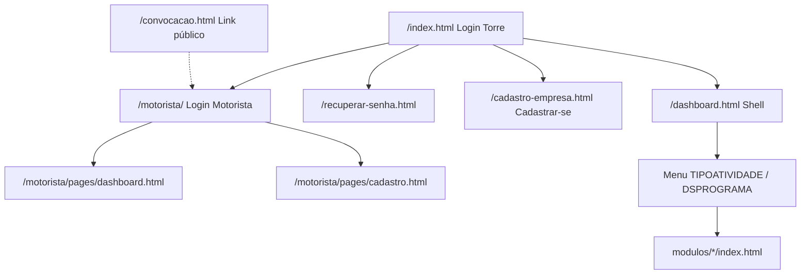
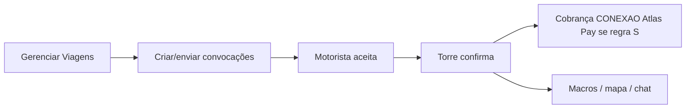

# Mapa de Navegação — Atlas Cargo

**Data:** 27/11/2026 · Base: `http://localhost:8083/`

## Entradas

## Hierarquia do menu (produto)

O dashboard filtra por módulo de produto (`geral`, Torre `divulga*`, Estoque `estoque`) e monta grupos `FGGRUPO`.

### Cadastros
1.0 Cadastro Geral → 1.1 Estados → 1.2 Mesorregião → 1.3 Cidade → 1.4 Tipo Validade

### Equipamentos
2.0 Veículos → 2.1 Marca → 2.2 Tipo → 2.3 Modelo → 2.4 Grupo → 2.5 Classe Frota

### Logística
3.0 Viagem → 3.1 Tipo Viagem → 3.2 Situação → 3.3 Roteiro → 3.4 Tipo Ocorrência → 3.5 Campanha

### Gestão
4.0 Convocações (relatório) → 4.1 Alertas → 4.2 Chat → 4.3 SOS → 4.4 Ranking → 4.5 Mapa → 4.6 Logs

### WMS
5.0 Painel → 5.1 Cadastros → 5.2 Recebimento → 5.3 Separação → 5.4 Cargas → 5.5 Expedição → 5.8 Baixas → 5.9 Relatórios → 6.0 Inventário → 6.1 Transferências → 6.2 Valor → 7.1 Cobrança  
Permissões sem tela: 5.6 Liberar Expedição, 5.7 Liberar Validade, Lib. picking OPL

### Sistema
9.0 Usuário → 9.1 Tipo Atividade → 9.2 Empresas → 9.3 Filiais → 9.4 Configurações → 9.5 Tenants SaaS → 9.6 Disparo WhatsApp → **9.7 Atlas Pay**

## Telas fora do menu (links internos)

| Tela | Como chega |
|---|---|
| `/convocacao.html` | Link WhatsApp / Switch / e-mail |
| `/cadastro-empresa.html` | Login “Cadastrar-se” |
| `/recuperar-senha.html` | Login “Esqueci minha senha” |
| `/motorista/pages/oportunidades-publicas.html` | Campanha / link público |
| `/bi-*.html` | Atalhos BI / API WMS |
| `/teste-mobile.html` | QA interno |
| Modais de Viagens (anúncio, comprovantes, mapa motorista, divergência placas) | Botões internos do módulo |
| Pedidos de acesso | Aba em Tenants SaaS (badge no dashboard) |

## Fluxos principais

### Torre — viagem e convocação

### WMS
Recebimento → Separação OPL → Cargas → Expedição → Relatórios / Inventário / Cobrança 7.1

### Atlas Pay
Contrato vigente → Cobranças ABERTA → Baixa/Cancelar → Fechamento de uso mensal → Gates em operações novas (Fase 4)

### Motorista
Login → Dashboard → Convocações/Cargas → Aceite → Viagem → Macros/GPS/Chat/SOS/POD

## Relação dashboard ↔ módulo
1. Usuário autentica → token em `localStorage`.  
2. `GET /api/menu/user-menu` retorna itens permitidos.  
3. Clique no item chama `loadModuleContent(DSPROGRAMA)` carregando `/modulos/{programa}/index.html`.  
4. Badges (chat, alertas, SOS, motoristas pendentes, pedidos SaaS) abrem o módulo correspondente.
